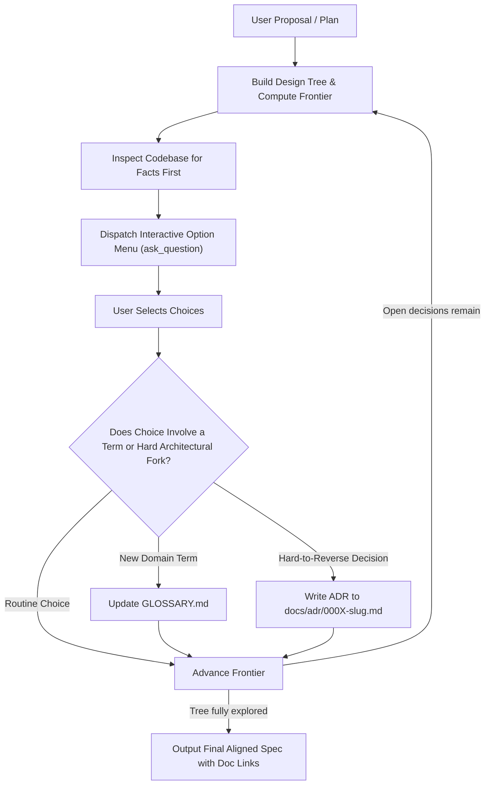

# Grill With Docs (Interactive Option Menu + Documentation Flow)

Combines Matt Pocock's relentless "Grill Me" interrogation with active domain modeling and documentation. As you make decisions through native interactive option menus (`ask_question`), this skill automatically drafts and updates:
1. **Architecture Decision Records (ADRs)** in `docs/adr/000X-<slug>.md`
2. **Domain Glossary** in `GLOSSARY.md` (or `docs/GLOSSARY.md`)
3. **Final Design Alignment Spec** ready for execution

---

## Core Philosophy

1. **Interactive Option Menus (`ask_question`):** Never ask the user to type answers to multiple-choice architectural forks in plain text. Present each round of frontier decisions through structured, interactive multi-choice option menus with concrete trade-offs and `(Recommended)` choices.
2. **Fact-Finding First:** Always inspect the repository (package.json, existing files, configs, APIs) before asking. Only ask for decisions, priorities, and domain trade-offs—never for facts you can determine from code.
3. **Capture Docs as You Go:** Do not wait until the end of the session to write documentation. The moment a critical architectural fork is selected or a domain term is clarified, write the ADR or update `GLOSSARY.md` immediately.

---

## The Interactive Grilling & Documentation Loop



---

## 1. Disagree & Propose via `ask_question`

For the current unblocked frontier of the design tree, call the `ask_question` tool:

- Group 2–4 unblocked decisions per round.
- Prepend the strongest default with `(Recommended)` and a clear rationale.
- Outline distinct alternative choices so the trade-offs are obvious.
- Set `is_multi_select: false` for mutually exclusive architectural choices.
- The UI automatically provides an `"Other"` free-form option if the user wishes to deviate.

---

## 2. Ingesting Choices & Generating Documentation

### When to Write an Architecture Decision Record (ADR)
Create an ADR in `docs/adr/000X-<slug>.md` whenever a decision meets all three criteria:
1. **Hard to reverse:** The cost of changing your mind later is significant (e.g. database choice, auth provider, API architecture).
2. **Surprising without context:** A future developer or agent will wonder "why did they build it this way?".
3. **Result of a real trade-off:** There were genuine alternatives and you selected one for specific reasons.

#### ADR Format (`docs/adr/000X-<slug>.md`):
```markdown
# {Sequential Number}: {Short title of the decision}

**Status:** Accepted  
**Date:** {YYYY-MM-DD}

## Context & Problem Statement
{1-2 sentences: what architectural challenge or trade-off required a decision.}

## Decision Outcome
Chosen option: "{Selected Option}", because {rationale and advantages over alternatives}.

## Consequences
- **Positive:** {Key benefits gained}
- **Negative / Trade-offs:** {Constraints accepted or operational costs}

## Considered Options
- {Option 1 (Chosen)}
- {Option 2 (Rejected and why)}
- {Option 3 (Rejected and why)}
```

---

### When to Update `GLOSSARY.md`
Whenever the user uses ambiguous terminology, introduces new system entities, or settles a domain definition, update or create `GLOSSARY.md` in the project root:

#### `GLOSSARY.md` Format:
```markdown
# Domain Glossary

Ubiquitous language and canonical terminology for this project.

## Terms

**{Canonical Term}**:
{A precise, one-to-two sentence definition of what this entity or concept means in this domain.}
_Avoid_: {Synonyms or colloquial terms that cause confusion, e.g. User, Account, Client}
```

*Rules:*
- Keep `GLOSSARY.md` strictly about domain concepts, not implementation details or code syntax.
- Add canonical terms inline during the session so subsequent questions use the exact language.

---

## 3. Session Conclusion: The Design Alignment Spec

Once all branches of the design tree have been explored and the frontier is empty:
1. Present the **Design Alignment Spec** summarizing:
   - **Settled Architecture:** High-level system design.
   - **Recorded ADRs:** Direct clickable links to newly generated files in `docs/adr/`.
   - **Domain Vocabulary:** Summary of terms updated in `GLOSSARY.md`.
   - **Implementation Roadmap:** Sequential, ticket-ready tasks for code implementation.
